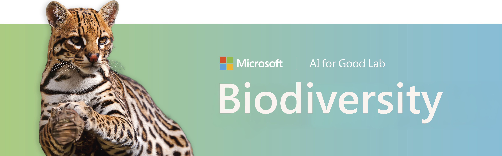

# Microsoft Biodiversity

**Open-source AI for biodiversity monitoring and conservation.**
Microsoft AI for Good Lab: the SPARROW ecosystem for camera-trap detection, bioacoustic analysis, species classification and field deployment.

## 📣 Announcements

### SPARROW: one ecosystem for AI in biodiversity monitoring

Our work started with **MegaDetector**, a camera-trap model for finding animals, people and vehicles that is now widely used in conservation. We then built **PyTorch-Wildlife** to host our detection and classification models in one place. Since then the work has grown to cover bioacoustics, overhead and aerial imagery, field hardware, and the software that moves data from remote sites to the cloud.

We now bring all of it together under one name: **SPARROW**. Each project has its own repository, so the code is easy to find and each project has a clear owner. This repository is the hub that links them. The table below lists every public project.

### PyTorch-Wildlife is now SPARROW Playground

We can no longer use the word "PyTorch" in our project names, and our inference now runs on [Sparrow Engine](https://github.com/microsoft/SPARROW-Engine), an inference engine written in Rust on ONNX Runtime, with its own Python package (`pip install sparrow-engine`) and our full model zoo. The PyTorch-Wildlife repository has been renamed and rebuilt as **[SPARROW Playground](https://github.com/microsoft/SPARROW-Playground)**: notebooks and small scripts for running the SPARROW tools on your own images, videos and audio, and reusing the code in your own projects. The Playground also has notebooks for live data from SPARROW devices, 4G e-mail cameras and FTPS cameras (through [Sparrow Comm](https://github.com/microsoft/SPARROW-Comm)), and for serving models over HTTP.

- Old `microsoft/Pytorch-Wildlife` links, issues and clones redirect to SPARROW Playground automatically.
- The old PyTorch-Wildlife code is kept, unmaintained, in the [`archive/pytorch-wildlife`](https://github.com/microsoft/SPARROW-Playground/tree/archive/pytorch-wildlife) branch and tag [`v1.3.1`](https://github.com/microsoft/SPARROW-Playground/tree/v1.3.1).
- The `PytorchWildlife` PyPI package ends at 1.3.1 and will get no further updates; we suggest switching to `sparrow-engine`. To install 1.3.1 in a new environment, add the packages it uses but does not declare: `pip install PytorchWildlife==1.3.1 soundfile librosa "setuptools<82"`.
- Fine-tuning has moved to dedicated repositories, starting with [microsoft/MegaDetector-Classifier](https://github.com/microsoft/MegaDetector-Classifier).

### Recent releases

- **[Sparrow Comm](https://github.com/microsoft/SPARROW-Comm) v0.1.0** (November 2026): receivers for SPARROW field data over the device API, Reconyx, e-mail and FTPS. `pip install sparrow-comm`
- **[Sparrow Engine](https://github.com/microsoft/SPARROW-Engine) v0.1.32** (November 2026): `pip install sparrow-engine`, or with Homebrew on macOS arm64 or Linux x86_64 `brew tap microsoft/sparrow-engine && brew install sparrow-engine`
- **[SPARROWmini](https://github.com/microsoft/SPARROWmini)**: a small solar-powered field node that runs detection on the device and sends results over a radio mesh to a SPARROW gateway or, where it has Wi-Fi or 4G, directly to the SPARROW server
- **[SPARROW Model Zoo Uploader](https://github.com/microsoft/SPARROW-Model-Zoo-Uploader)**: a toolkit for converting a model, checking that its outputs match the original, and submitting it to the Sparrow Engine model zoo

#### Previous versions
- [PyTorch-Wildlife release notes](releases/release_notes.md) (ended with 1.3.1)

## Projects

Not sure where to start? The [project catalogue](ecosystem.md#which-project-should-i-use) matches common tasks to projects and links the model zoo.

### AI models

| Repo | What it is |
|---|---|
| [microsoft/MegaDetector](https://github.com/microsoft/MegaDetector) | AI model for detecting animals, people and vehicles in camera-trap images; where it all started ([documentation](https://microsoft.github.io/MegaDetector/)) |
| [microsoft/MegaDetector-Classifier](https://github.com/microsoft/MegaDetector-Classifier) | Camera-trap species classification and fine-tuning for your own datasets and regions |
| [microsoft/MegaDetector-Acoustic](https://github.com/microsoft/MegaDetector-Acoustic) | Bioacoustic AI: species detection and classification from sound recordings |
| [microsoft/MegaDetector-Overhead](https://github.com/microsoft/MegaDetector-Overhead) | Wildlife detection in drone and aerial imagery (OWL models) |
| MegaDetector-Sonar | Wildlife detection in sidescan sonar imagery. *Coming soon.* |

### SPARROW software

| Repo | What it is |
|---|---|
| [microsoft/SPARROW-Engine](https://github.com/microsoft/SPARROW-Engine) | Inference engine (Rust, ONNX Runtime) for camera-trap and audio models, with the model zoo. Python package, `spe` CLI, HTTP server and C library. Also on [Homebrew](https://github.com/microsoft/homebrew-sparrow-engine) |
| [microsoft/SPARROW-Playground](https://github.com/microsoft/SPARROW-Playground) | Notebooks and scripts for trying the SPARROW tools on your own data; formerly PyTorch-Wildlife |
| [microsoft/SPARROW-Comm](https://github.com/microsoft/SPARROW-Comm) | Receivers for field data: SPARROW devices, Reconyx, e-mail cameras and FTPS cameras |
| [microsoft/SPARROW-Model-Zoo-Uploader](https://github.com/microsoft/SPARROW-Model-Zoo-Uploader) | Convert a model, check it matches the original, and submit it to the Sparrow Engine model zoo |

### SPARROW hardware

| Repo | What it is |
|---|---|
| [microsoft/SPARROW](https://github.com/microsoft/SPARROW) | Solar-Powered Acoustic and Remote Recording Observation Watch: an AI edge device for remote field sites, with 4G or satellite uplink |
| [microsoft/SPARROWmini](https://github.com/microsoft/SPARROWmini) | Small, low-power field node (Raspberry Pi Zero 2 W) that runs detection on the device and sends results over a radio mesh to a SPARROW gateway, or directly over Wi-Fi or 4G |

## Cite us

When citing work that uses any of the repositories under this umbrella, please cite:

- **Hernandez et al. 2024**, *Pytorch-Wildlife: A Collaborative Deep Learning Framework for Conservation* ([arXiv:2405.12930](https://arxiv.org/abs/2405.12930)), for the PyTorch-Wildlife framework, Sparrow Engine, SPARROW Playground, or models accessed through them
- **Beery, Morris, Yang 2019**, *Efficient Pipeline for Camera Trap Image Review* ([arXiv:1907.06772](https://arxiv.org/abs/1907.06772)), for any use of MegaDetector
- **Lavista Ferres et al. 2025**, *Listening to the Earth in Real Time: SPARROW and the Future of Conservation Technology*, for the SPARROW devices (paper in preparation)

See [Cite us](cite.md) for BibTeX entries.

## Contributing

We welcome community contributions. See our [Contribution Guidelines](contribute.md#how-to-participate) for how to participate.

## Community

Have questions or want to connect with the team? Join us on [Discord](https://discord.gg/TeEVxzaYtm), or [email us](mailto:zhongqimiao@microsoft.com).

A list of organizations using MegaDetector across global conservation work is maintained on the [microsoft/MegaDetector](https://github.com/microsoft/MegaDetector) repository.

## About

Maintained by [Microsoft AI for Good Lab](https://www.microsoft.com/en-us/research/group/ai-for-good-research-lab/).
